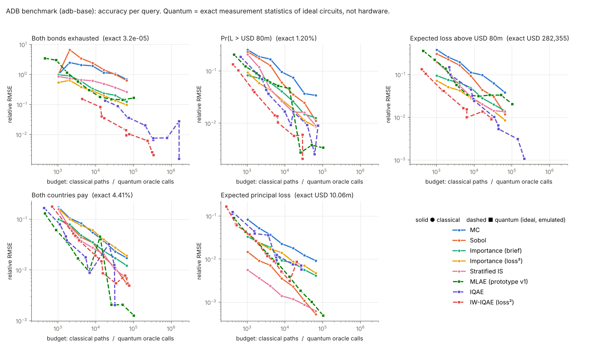

# Qubit Happens: importance-weighted amplitude estimation for the rare joint tail

**ADB Quantum Innovation Challenge 2026, Phase 1 lightweight prototype** · Team **Qubit Happens** (ID 6746):
Ivan Cheong, Tan Boon Xuan, Loh Shi Lynn

Joint-loss modelling for the Kyrgyz Republic / Tajikistan Disaster Relief Bond benchmark defined in the
challenge brief (two bonds of USD 80m, earthquake and precipitation sub-limits, 3-year term, 5 targets,
5 scenarios).

> **Status.** Everything here runs on a CPU. **No quantum hardware was used.** Quantum results are the
> exact measurement statistics of *ideal* circuits (the `sin²((2k+1)θ)` law, validated against a full
> statevector simulation), and costs are counted in oracle queries, not wall-clock time.

## Headline results

* The exact reference model **reproduces all 25 values of the brief's Table 5**.
* **Iterative QAE** removes the ~15% error plateau of fixed-schedule MLAE and returns confidence
  intervals (empirical coverage 0.95-1.00).
* **Importance-weighted IQAE** (grid-snapped proposal, exactly unbiased): on the rare joint tail
  ("both bonds exhausted", about 3 in 100,000), relative error is **1.3-1.8% versus 7.2-14.9% for the
  best classical method at equal budget, in all five scenarios** (4-9× more accurate).
* **Where classical still wins:** on expected loss, stratified importance sampling (a stronger
  classical baseline we added) is about 4× more accurate than QAE. We report this.
* **Gate-level resource estimate.** The oracles are built and verified in Qiskit. Plain oracle A: 39
  logical qubits and 850 CX. Grover operator: 6,494 CX. Also reported: T-counts, surface-code
  distance, NISQ feasibility, error mitigation and hardware mapping.
* **Scaling argument** for larger portfolios: see [docs/SCALING.md](docs/SCALING.md).



## Repository structure

| Path | Purpose |
|---|---|
| `jointloss/model.py` | Exact reference model (brief steps 1-8): compound-Poisson earthquake CTMC with shared events, correlated precipitation, 100-state annual law, 3-year capped convolution, 5 targets, 5 scenarios |
| `jointloss/baselines.py` | The brief's classical baselines (step 9): Monte Carlo, scrambled Sobol, stratified, importance sampling |
| `jointloss/qae.py` | QAE payoff over all 10⁶ three-year paths, explicit statevector check of `Q^k A\|0>`, MLAE estimator (v1) |
| `jointloss/iqae.py` | Iterative QAE (Grinko et al. 2021) emulated at the level of measurement statistics |
| `jointloss/weighted.py` | Importance-weighted amplitude encoding with a grid-snapped (exactly unbiased) proposal |
| `jointloss/scaling.py`, `run_scaling.py` | n-country generalisation, exact large-n references, query and gate scaling |
| `resources/build_circuits.py` | Builds and **verifies** the oracles in Qiskit, then counts qubits, CX, depth, T-gates |
| `run_benchmarks.py`, `make_plots.py` | v1 benchmark (MLAE vs the brief's baselines) → `results/results.json`, `results/error_vs_budget.png` |
| `run_benchmarks_v2.py`, `make_plots_v2.py` | v2 benchmark (IQAE, IW-IQAE, stronger classical baselines, all scenarios) → `results/v2_results.json`, `results/v2_error_vs_budget.png` |
| `docs/V2_NOTES.md` | Methods, results and resource estimate in detail |
| `docs/SCALING.md` | Scaling to larger portfolios |
| `submission/` | Technical proposal PDF and presentation deck (with their source) |

## Setup and execution

```bash
python -m venv .venv && source .venv/bin/activate      # optional
pip install -r requirements.txt                          # numpy, scipy, matplotlib, qiskit
python run_benchmarks.py 40          # v1 benchmark            (~1 min)
python make_plots.py
python run_benchmarks_v2.py 40       # v2 benchmark            (a few minutes)
python make_plots_v2.py
python -m resources.build_circuits   # verify + cost circuits  (~1 min)
python run_scaling.py                # scaling study           (a few minutes)
```

All scripts use the fixed seed 2026 and write to `results/`. Outputs committed in `results/` are the
ones reported in the proposal (`results/run.log` and `results/v2_run.log` are the execution logs).

## Hardware and simulator details

* **Hardware:** CPU only, no GPU and no quantum processor. v1 results were produced on a laptop CPU
  (1 core). v2, the resource estimate and the scaling study were produced on an Intel Xeon @ 2.10 GHz
  (4 vCPU, single-threaded runs).
* **Software as run:**
  * v1: Python 3.12.3, NumPy 2.5.4, SciPy 1.18.1, Matplotlib 3.11.2.
  * v2: Python 3.13.18, NumPy 2.5.3, SciPy 1.18.1, Matplotlib 3.11.2, Qiskit 2.6.2.
* **Simulators:**
  * Our own NumPy statevector check (2²¹×2 amplitudes) of the Grover iterates.
  * Measurement-statistics emulation of MLAE and IQAE.
  * Qiskit transpiler for gate counts (basis `cx, rz, sx, x`; heavy-hex coupling via `GenericBackendV2`).
  * A bit-level simulator that checks the reversible arithmetic on all 10⁶ paths.

## Version history in this repo

* **v1** (`run_benchmarks.py`): MLAE vs the brief's four baselines. Ideal MLAE beat Monte Carlo, Sobol
  and stratified sampling on the rare tail, but plateaued around 15% RMSE and only edged importance
  sampling. Details are in the v1 sections of `results/results.json`.
* **v2** (`run_benchmarks_v2.py`, `resources/`): IQAE, importance-weighted IQAE, two stronger
  classical baselines, and verified gate-level costing. See [docs/V2_NOTES.md](docs/V2_NOTES.md).

## Phase 2 plan (summary)

1. Build a unary-iteration QROM for the weight lookup and an ancilla-assisted reflection; re-cost with
   a full fault-tolerant estimator.
2. Run noisy simulation and small-k hardware demonstrations with error mitigation, on GPU credits.
3. Scale to n ≥ 5 countries with factor-structured loaders and tensor-train references.
4. Cover the World Bank event-loss-table worked example and importance weighting for expectation
   targets.

## AI-use disclosure

The code, benchmark harnesses, documentation and submission materials were drafted with the
assistance of Claude (Anthropic). The authors are responsible for reviewing and verifying the code
and results. Model equations and benchmark definitions come from the ADB Quantum Challenge brief.
